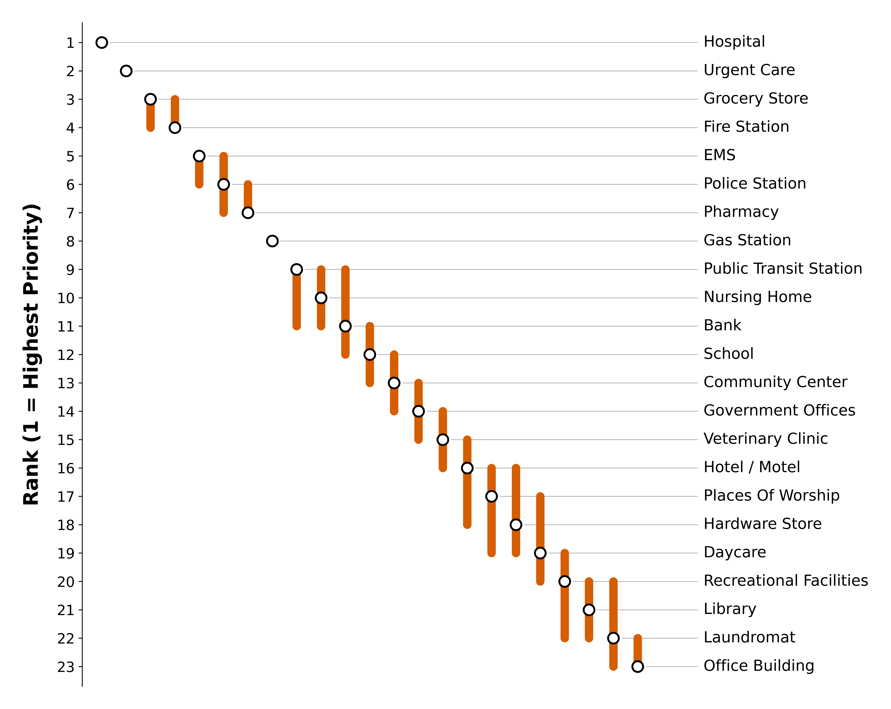
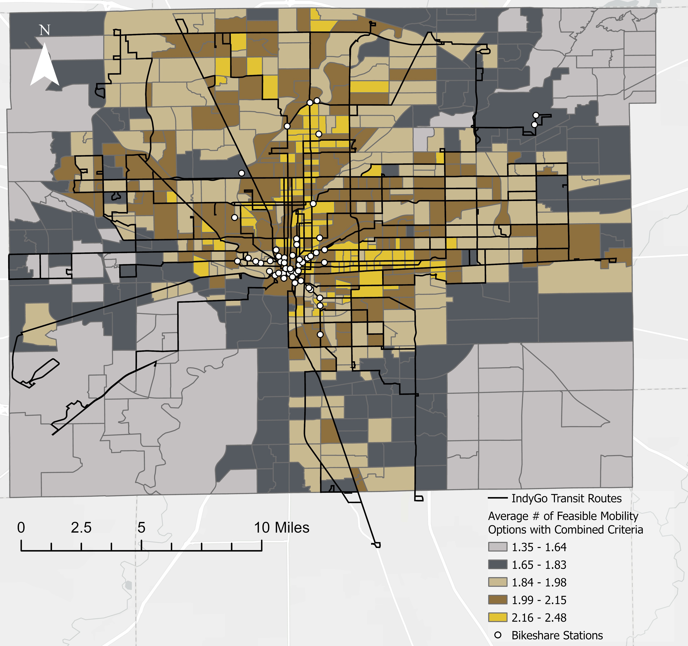
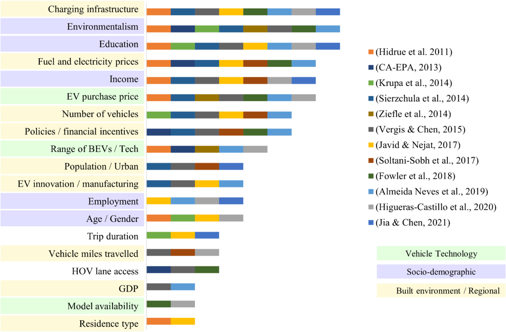
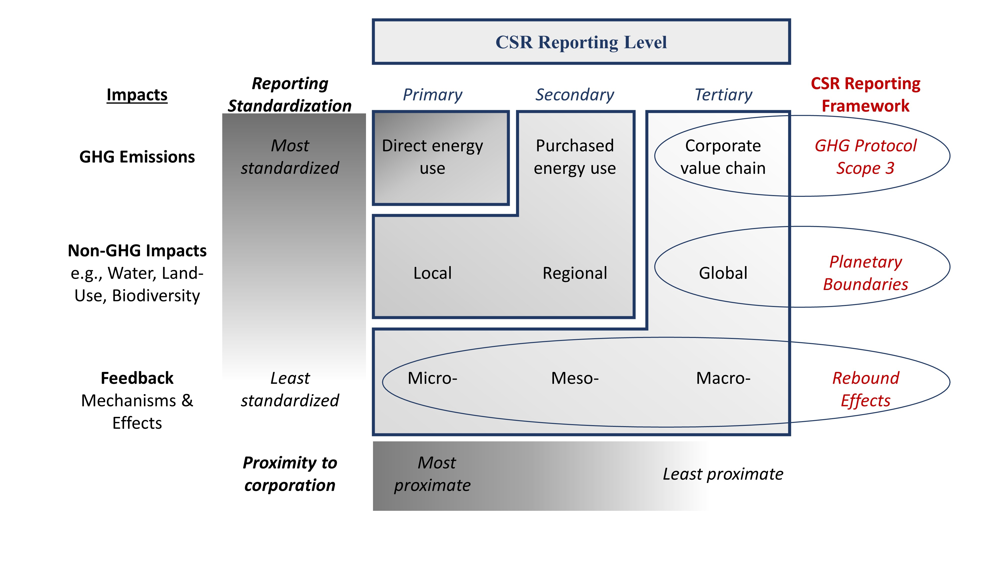
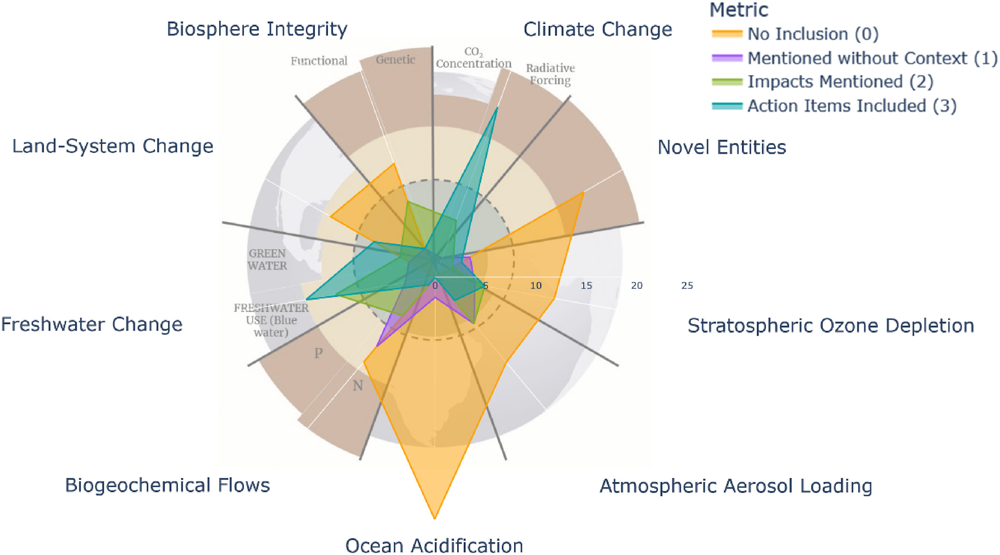

My research develops **systems-based, data-driven, and community-informed approaches** to understand how infrastructure shapes everyday opportunities and how communities experience environmental and infrastructure disruption. Three research directions connect my work.

## Critical and Essential-service Access and Community Resilience

**Who can access critical and essential services, how fragile is that access, and how can we make it more resilient?**

My research examines how transportation and infrastructure systems shape people's ability to access critical and essential services (CES), including health care, education, and emergency services. Moving beyond traditional measures of facility availability and proximity, I develop accessibility-based approaches to assess whether populations can reach essential services, what alternatives are available to them, and how vulnerable that access may be to infrastructure disruptions and natural hazards.

In [*Evaluating critical and essential service access vulnerabilities*](https://doi.org/10.1088/1748-9326/adee30), my coauthors and I co-developed measures of service-access fragility, facility criticality, and equity with community members who attended our workshops. Building on this foundation, my ongoing research examines geographic and sociodemographic disparities in access to essential services across the United States, including differences in health-care accessibility and their implications for population well-being. I am also extending these approaches to evaluate how coastal hazards, infrastructure disruptions, and climate adaptation strategies affect communities' ability to maintain access to essential services over time.

::: {.text-muted .small}
Building on this foundation, three nationwide studies currently in preparation for publication examine complementary dimensions of access to critical and essential services: (1) geographic and demographic disparities in health-care access and their implications for health outcomes; (2) regional differences in essential-service accessibility, access fragility, and facility criticality; and (3) distributional inequities in essential-service access across sociodemographic groups.

I am also extending these approaches to evaluate how coastal hazards, infrastructure disruptions, and climate adaptation strategies affect communities' ability to maintain access to essential services over time.
:::

### Interactive Research Dashboards

#### Essential Service Access and Facility Criticality

Explore the fragility of access to critical and essential services and the criticality of individual facilities across selected communities in coastal Louisiana.

<iframe
  src="https://utkuhangenc.github.io/fragility_criticality/"
  width="100%"
  height="600"
  style="border: 1px solid #ddd; border-radius: 8px;"
  title="Essential Service Access Dashboard"
  loading="lazy">
</iframe>

[Open Full Dashboard](https://utkuhangenc.github.io/fragility_criticality/){.btn .btn-outline-primary target="_blank"}

---

#### Decision Support Dashboard

This dashboard was developed by Jordan Fischbach and Patrick Kane of The Water Institute as part of the NASEM Gulf Research Program project on incorporating equity and social vulnerability into flood-risk mitigation strategies. I contributed the underlying data necessary for its development.

<iframe
  src="https://public.tableau.com/views/NAS_Equity_Dashboard_20240401/AboutThisStudy?:showVizHome=no&amp;:embed=true&amp;:tabs=no&amp;:toolbar=yes"
  width="80%"
  height="600"
  style="border: 1px solid #ddd; border-radius: 8px;"
  title="Flood Risk Mitigation and Equity Dashboard"
  loading="lazy">
</iframe>

[Open Full Tableau Dashboard](https://public.tableau.com/views/NAS_Equity_Dashboard_20240401/AboutThisStudy){.btn .btn-outline-primary target="_blank"}

[Learn More About the Project](https://thewaterinstitute.org/projects/incorporating-equity-and-social-vulnerability-into-the-design-of-flood-risk-mitigation-strategies){.btn .btn-outline-secondary target="_blank"}

### Selected Publications and Ongoing Manuscripts

- [Evaluating critical and essential service access vulnerabilities (2025)](https://doi.org/10.1088/1748-9326/adee30) — *Envrionmental Research Letters*.

**In the Publication Process**

- *Regional and Demographic Differences in Health Care Access in the USA * — Manuscript in preparation.

- *Nationwide Fragility of Essential Service Access and Criticality of Facilities* — Manuscript in preparation.

- *Distributional Justice in Essential Service Access: A Nationwide Analysis of Sociodemographic Inequities* — Manuscript in preparation.

*Methods:* transportation network analysis, GIS, spatial accessibility, infrastructure disruption modeling, and equity analysis.

## Robust Decision-Making for Infrastructure and Climate Adaptation

**Which infrastructure investments remain effective across uncertain futures and divergent stakeholder priorities?**

My research develops decision-support approaches to identify infrastructure and climate-adaptation strategies that remain effective across uncertain futures and divergent stakeholder priorities. I combine multi-criteria decision analysis with robustness analysis to examine how infrastructure investment priorities change under different assumptions and competing objectives. Rather than requiring agreement on a single set of subjective weights, these approaches identify priorities that remain stable across alternative decision perspectives, helping planners make more transparent and defensible decisions.

Through my professional work at Arcadis, I have applied these approaches to statewide transportation flood-risk assessment and infrastructure prioritization. These experiences inform my broader research on bridging methodological advances with the institutional constraints, uncertainties, and practical challenges of infrastructure and climate-adaptation planning.

::: {.text-muted .small}

Project status (as of ): The applied project described above has not been publicly released. The identity of the state transportation agency and project-specific details remain confidential. Relevant files will be shared once the project is released to public.

:::

### Selected Publications and Ongoing Manuscripts

- [Evaluating critical and essential service access vulnerabilities (2025)](https://doi.org/10.1088/1748-9326/adee30) — *Envrionmental Research Letters*.

*Methods:* robust decision-making, multi-criteria evaluation, risk analysis, scenario analysis, and systems modeling.

## Community-Informed Infrastructure Prioritization

**Which critical and essential services should be prioritized for protection, and how can community preferences inform these decisions?**

:::: {.grid}

::: {.g-col-12 .g-col-md-8}

Infrastructure risk-mitigation decisions often rely on engineering and economic measures that do not fully capture what communities consider important to protect. My research examines how residents prioritize critical and essential services, how these preferences vary across individuals, and how community priorities can be incorporated into infrastructure investment decisions alongside conventional risk measures.

In my doctoral research on seismic risk mitigation, I use Best-Worst Scaling and discrete-choice modeling to elicit residents' preferences for protecting essential-service facilities in Los Angeles. I integrate these findings into multi-criteria decision-support frameworks to examine how community priorities can inform seismic retrofit prioritization.

Beyond seismic risk, I aim to develop transferable approaches that enable communities to shape the objectives and tradeoffs used in infrastructure and climate-adaptation planning. This work emphasizes community engagement as a collaborative process in which local knowledge informs not only the evaluation of potential interventions, but also how planning problems are defined.

:::

::: {.g-col-12 .g-col-md-4}

{width=100%}

::: {.text-muted .small}

*Points indicate the estimated rank of each service based on its multinomial logit coefficient, with Rank 1 representing the highest-priority service. Vertical bars show the range of ranks that cannot be statistically distinguished based on pairwise coefficient-difference tests.*

:::

:::

::::

### Selected Publications and Ongoing Manuscripts

- [Community Centered Risk Mitigation: a Case Study of Seismic Retrofit Decisions]((https://doi.org/10.2139/ssrn.7629364)- Under review, *International Journal of Disaster Risk Reduction*.

*Methods:* Best-Worst Scaling, discrete-choice modeling, and community-engaged research

## Equitable Mobility and Sustainability Transitions

**How can transitions toward sustainable transportation expand mobility opportunities without creating new inequities?**

:::: {.grid}

::: {.g-col-12 .g-col-md-8}

My transportation research examines how mobility opportunities, infrastructure investments, and sustainability transitions distribute benefits and burdens across communities.

In my [master's research](https://www.proquest.com/openview/0a68eb8ec5cc6d122b65f4b33fb48ab2/1?pq-origsite=gscholar&cbl=18750&diss=y), I developed a capabilities-based framework for transportation equity that considers individuals' actual travel needs and the feasibility of alternative transportation modes. Using GPS-based travel behavior data, this work moves beyond the geographic availability of transportation options to examine whether individuals have realistic alternatives for meeting their daily mobility needs. An associated manuscript on mode choice and mobility-option equity is currently in preparation.

My subsequent research examines the transition to electric vehicles (EVs) and its implications for urban equity. In a published study, my coauthors and I investigated the role of the built environment in [EV adoption](https://doi.org/10.1016/j.jtrangeo.2025.104115). Building on this work, my ongoing research examines whether EV charging infrastructure investments, despite their environmental benefits, may contribute to unintended pressures on housing affordability and exacerbate existing urban inequalities.

A complementary direction of my research investigates [rebound and tertiary effects](https://doi.org/10.1016/j.clrc.2024.100235) associated with sustainability transitions. This includes system dynamics modeling of behavioral and economic responses to energy savings, as well as research on how corporations disclose the indirect consequences of their sustainability initiatives.

:::

::: {.g-col-12 .g-col-md-4}

{width=100%}

{width=100%}

:::

::::

:::: {.grid}
::: {.g-col-12 .g-col-md-6}
{width=100%}
:::

::: {.g-col-12 .g-col-md-6}
{width=100%}
:::
::::
### Selected Publications and Ongoing Manuscripts

**Published**

- [Electric Vehicle Adoption and Planning: The Increasing Importance of the Built Environment (2025)](https://doi.org/10.1016/j.jtrangeo.2025.104115) — *Journal of Transport Geography*.

- [Emerging Concerns in Sustainability Reporting: Disclosure of Tertiary Effects in the Home Appliance Industry (2024)](https://doi.org/10.1016/j.clrc.2024.100235) — *Cleaner and Responsible Consumption*.

**In the Publication Process**

- *Cost of Green Mobility: Assessing the Equity Implications of Electric Vehicle Charging Infrastructure Development on Urban Housing Affordability* — Accepted with minor revisions, *Communications Sustainability*.

- *Analyzing Mode Choice and Mobility Option Equity Using GPS Data* — Manuscript in preparation.

- *Integrating re-spending into STIRPAT equation to measure rebound effect* — Manuscript in preparation.

