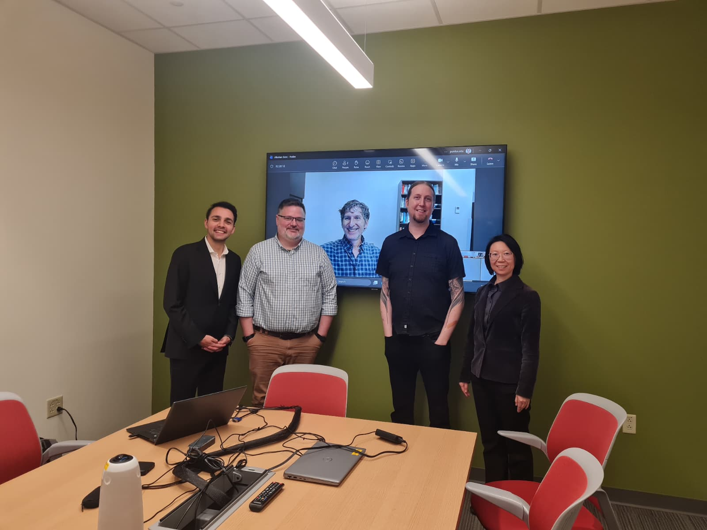
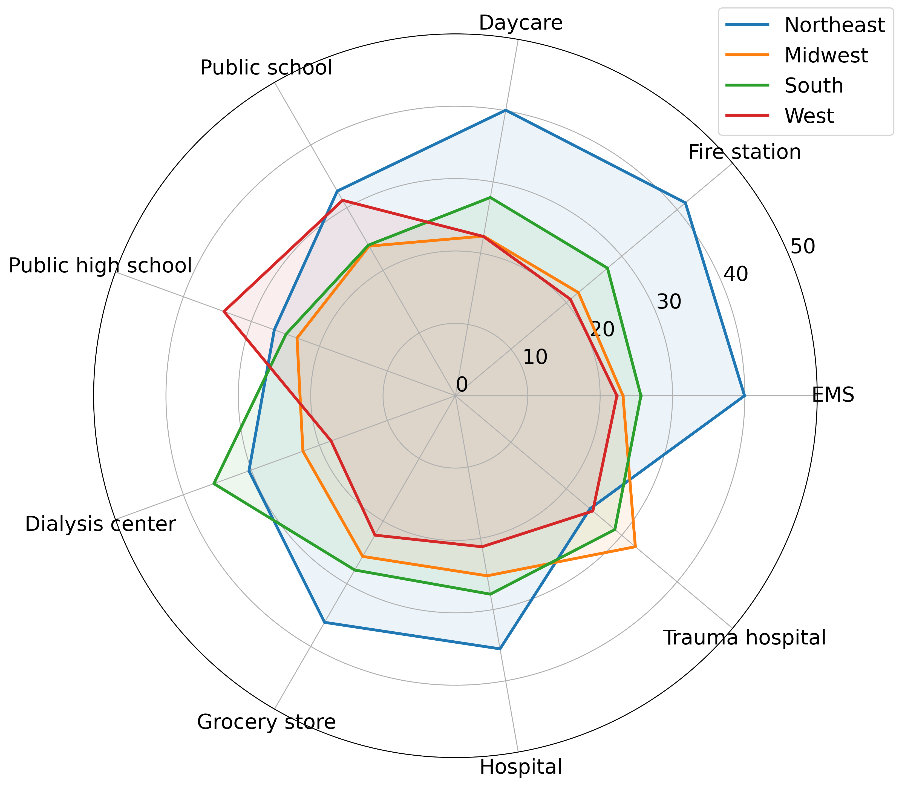
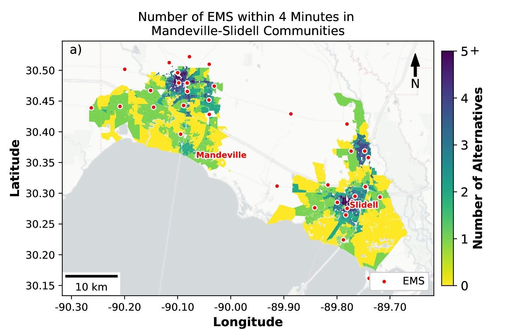

## 2026

### **Integrating Equity and Community Perspectives in Seismic Retrofit Decisions.** 
*Natural Hazards Research and Applications Workshop, Researchers Meeting*, Broomfield, Colorado.

I presented preliminary results from our best-worst scaling survey that was fielded in Los Angeles County among households with less than $100,000 income. The target group was selected because low-income households have fewer opportunities to participate directly in formal decision-making process. We used Best-Worst Scaling with Balanced Incomplete Block Design to quantify priority rankings of 23 different critical and essential services with minimal cognitive burden on respondents. 
[View Slides (PDF)](assets/slides/NHW_2026.pdf)

Preprint of this work available here: [Community Centered Risk Mitigation: a Case Study of Seismic Retrofit Decisions](https://papers.ssrn.com/sol3/papers.cfm?abstract_id=7629364).

### **Community-Centered Measures for Natural Hazards Risk Management**
*Preliminary Dissertation Exam*, West Lafayette, Indiana

Pictured below are my committee members: [Prof. Aaron Thompson](https://ag.purdue.edu/department/nres/faculty-research-areas/hort-department/aaron-thompson.html), [Prof. David Johnson](https://engineering.purdue.edu/IE/people/ptProfile?resource_id=126281), [Prof. Hua Cai](https://engineering.purdue.edu/IE/people/ptProfile?resource_id=126285), and my external committee member [Prof. Scott Hemmerling](https://publichealth.lsuhsc.edu/people/faculty/faculty-list/hemmerling-scott.aspx)

{width=100%}

### **Inequities in Access to Essential Services in the U.S.**

*Preferred Futures: Climate and Environmental Justice Across Borders*, Stanford University.

:::: {.grid}

::: {.g-col-12 .g-col-md-8}

I gave a brief presentation on regional results from our nationwide analysis of access to critical and essential services. Figure shows population-weighted service-access profiles by Census region and service type. Radar plots show composite access scores for nine essential service types across four Census regions. Scores range from 0 to 1, with higher values indicating stronger access based on relative drive time to the nearest facility, relative drive time to the second-nearest facility, and the share of the population with at least two facilities within the service-specific critical time threshold. 

::: {.text-muted .small}
© 2026 Utkuhan Genc and coauthors.
Preliminary, unpublished research findings.
Please do not reproduce, redistribute, or use
this figure without prior written permission.
:::

:::

::: {.g-col-12 .g-col-md-4}

{width=100%}

:::

::::

### **Using Equitable Access to Essential Services as Guidance for Investments in Coastal Adaptation.** 
*American Association of Geographers Annual Meeting*, San Francisco.

:::: {.grid}

::: {.g-col-12 .g-col-md-8}

In this presentation, I highlighted the importance of assessing the fragility of people's access to critical and essential services to better understand community resilience, drawing on findings from case studies in Louisiana. I also proposed a robustness analysis framework for prioritizing critical facilities, demonstrating how preferred actions may remain robust even when decision-makers have divergent priorities.

Relevant published work can be accessed here: [Evaluating critical and essential service access vulnerabilities](https://doi.org/10.1088/1748-9326/adee30)

[View Slides (PDF)](assets/slides/AAG_2026.pdf)

:::

::: {.g-col-12 .g-col-md-4}

{width=100%}

:::

::::

### What Makes Access Resilient? New Perspectives on Critical and Essential Service Access

*Next Generation Transportation Research Working Group Seminar*, University of Arkansas (invited seminar).

In this presentation, I shared Arkansas-specific findings from our nationwide analysis of access to critical and essential services, highlighting geographic differences in accessibility and the importance of evaluating the fragility of service access. The presentation includes original figures and adapted versions of figures from ongoing research that is currently being prepared for publication.

::: {.text-muted .small}

**Note:** Some figures in the presentation present preliminary, unpublished research findings. © 2026 Utkuhan Genc and coauthors. Please do not reproduce, redistribute, or reuse these figures without prior written permission.

:::

[View Slides (PDF)](assets/slides/UA_2026.pdf)

## 2025

### **Integrating Equity and Community Perspectives in Seismic Retrofit Decisions.** 
*Society for Risk Analysis Annual Meeting*, Washington, DC.

This presentation introduced the initial, risk-focused version of our seismic retrofit prioritization framework using a case study in Los Angeles. For updated findings and figures, as well as the associated preprint, please refer to the more recent presentation at Natural Hazards Workshop in 2026.
[View Slides (PDF)](assets/slides/SRA_2025_Seismic_Risk.pdf)

### **Using Equitable Access to Essential Services as Guidance for Investments in Coastal Adaptation.** 
*Arcadis North America Monthly Seminar Series*, San Francisco (invited seminar).

I was invited to give a talk to the Water Resources and Climate Adaptation team at Arcadis's San Francisco office. In this presentation, I discussed how the fragility of access to critical and essential services can inform social measures of infrastructure criticality and how robustness analysis can support infrastructure prioritization and decision-making. Rather than requiring agreement on a single set of subjective weights, the proposed framework identifies priorities that remain stable across different decision-maker perspectives. 
[View Slides (PDF)](assets/slides/Arcadis_2025.pdf)

An example visualization of the robustness analysis framework is shown below. Each color represents the ranking assigned to a particular facility under different combinations of weights across three outcome measures. Regions with the same color indicate weighting combinations that produce the same ranking, illustrating how robust the facility's prioritization is to differences in decision-maker preferences.
<iframe
  src="assets/images/robustness1.html"
  width="100%"
  height="550"
  style="border: none;"
  title="Interactive essential service accessibility figure">
</iframe>

## **Using Equitable Access to Essential Services as Guidance for Investments in Coastal Adaptation.** 
*State of the Coast 2025*, New Orleans, Louisiana

This presentation was awarded the third best student presentation at the conference. [View Slides (PDF)](assets/slides/SOC_2025.pdf)

## 2024

## **Identifying Vulnerable Communities Through Essential Service Access.** 
*Society for Risk Analysis Annual Meeting*, Austin, Texas. 
[View Slides (PDF)](assets/slides/SRA_2024.pdf)

## **Identifying Critical Essential Service Facilities Using Accessibility Measures.** 
*Society for Decision Making Under Deep Uncertainty Annual Conference*, Denver, Colorado.
[View Slides (PDF)](assets/slides/DMDU_2024.pdf)

## 2023

- **Using Travel Time to Essential Services to Identify Vulnerable and Fragile Communities.** Society for Risk Analysis Annual Meeting, Washington, DC. [View Slides (PDF)](assets/slides/SRA_2023.pdf)
- **A System Dynamics Model for Simulating Rebound Effects Induced bt Energy Savings with Re-spending Scenarios.** Sustainable Consumption Research and Action Initiative-European Roundtable for Sustainable Consumption and Production Joint Conference, Wageningen, The Netherlands [View Slides (PDF)](assets/slides/SCP_2023.pdf)
- **How do active travel modes enhance transportation equity and why don’t people use them?** International Society for Industrial Ecology, Leiden, The Netherlands [View Slides (PDF)](assets/slides/ISIE_2023.pdf)
- **Using Travel Time to Essential Services to Identify Vulnerable and Fragile Communities.** At What Point Managed Retreat?: Habitability and Mobility in an Era of Climate Change,  Columbia University [View Slides (PDF)](assets/slides/MR_2023.pdf)
- **A System Dynamics Model for Simulating Rebound Effects Induced by Energy Savings with Re-spending Scenarios.** International Symposium on Sustainable Systems and Technology, Fort Collins, Colorado. [View Slides (PDF)](assets/slides/ISSST_2023.pdf)
- **Applied Science for Non-Structural Adaptation Planning, A Case Study in Mandeville, LA. – Using Travel Time to Essential Services to Identify Vulnerable and Fragile Communities.** - State of the Coast 2023, New Orleans, Louisiana [View Slides (PDF)](assets/slides/SOC_2023.pdf)
